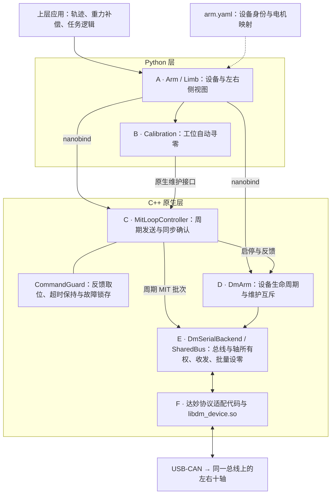

# DM OpenArm

达妙电机**双臂**控制库（C++17 + Python）。  
通信：`libdm_device.so`（dmcan）+ **经典 CAN 1 Mbps**（与 `resources/u2canfd` 工位实测一致）。

| 能力 | 说明 |
|------|------|
| MIT 力矩模式 | guarded 默认 250 Hz，调度上限 1000 Hz |
| 双臂 | 左 `0x00–0x04` / 右 `0x05–0x09`，同一总线 |
| 前馈力矩 | 由上层应用计算后写入 `MitCommand.tau` |
| 收发频率诊断 | 1 秒滑动窗口统计整臂 TX 和逐电机 RX |

---

## 快速开始

```bash
# 依赖（Debian/Ubuntu）
sudo apt install -y build-essential cmake pkg-config libyaml-cpp-dev libusb-1.0-0-dev
python3.13 -m venv .venv && source .venv/bin/activate
pip install -e ./dm_openarm

# 扫描 10 轴是否在线
python python_script/scan_motors_online.py
```

唯一站位配置：`dm_openarm/config/arm.yaml`（**必须**含 `left:` + `right:`，无根级 `motors:`）。

改 C++ 后需重新 `pip install -e ./dm_openarm`。

构建发布 wheel：

```bash
python -m build --wheel --no-isolation --outdir dist dm_openarm
```

当前版本 **0.1.13**，发布 wheel 适用于 **CPython 3.13 / Linux x86_64**。wheel、构建记录和安装说明位于 `dist/`；可追溯构建步骤见
[`dist/USAGE_GUIDE.md`](dist/USAGE_GUIDE.md#构建与来源记录)。guarded 启动默认 **250 Hz**，
兼容裸入口默认 1000 Hz；最高支持 1000 Hz，频率均由运行时参数指定。

0.1.13 统一设零检查与批量保护、改用被动在线扫描、修正停止状态，并拒绝空 MIT 更新。
兼容性变化、验证范围与升级说明见 [更新日志](dist/RELEASE_NOTES_0.1.13.md)。

---

## 硬件与 ID

| 项目 | 值 |
|------|-----|
| 链路 | 经典 CAN 1M（`canfd: false`, `brs: false`） |
| USB SN | `52A871B1AA5EF4E239371A5083463F26`（改适配器改 YAML） |
| 控制 | MIT，guarded 默认 250 Hz |

| 侧 | CAN | MST | 顺序 | 型号 |
|----|-----|-----|------|------|
| **left** | 0x00…0x04 | 0x10…0x14 | 配置向量：腕远端 → 肩 | J1/J2 DM8009，J3–J5 DM4340P |
| **right** | 0x05…0x09 | 0x15…0x19 | 同上 | 同上 |

---

## 架构（怎么用 API）



- **A：Arm / Limb**：一个 `Arm` 持有一个 MIT 循环；`Limb` 限制本侧 CAN ID，共享父对象的命令期限。
- **B：Calibration**：Python 编排扫描，原生层独占执行与提交，保留取消和部分写入报告。
- **C：Loop / Guard**：guarded 默认 250 Hz；启动从新鲜反馈保持当前位置，停止统一进入终态，重启重新取位。
- **D / E：设备与总线**：单轴、单侧、整臂设零均调用同一个原生批量实现，统一检查失能与连续静止反馈。
- **E：SharedBus**：两个 `Arm.from_yaml(..., side=...)` 可共享 USB 连接，各自持有独立控制循环和命令期限。
- **F：协议与驱动**：MIT 编码、状态解码、USB 收发；发送成功表示接口已提交，不等于机械动作确认。

---

## Python API

### 设备级 `Arm`

| 方法 | 作用 |
|------|------|
| `Arm.from_yaml(path, side=None)` | 加载双臂或指定单臂配置，不连设备 |
| `enable()` / `disable()` | 连接使能 / 停 loop + 失能 |
| `enable_seeded(gains, hz=250, ...)` | guarded 启动，首次完整保持批次提交成功后返回 |
| `start_mit_loop(hz=1000, home=False)` | 兼容入口；新对象不会自动启用 CommandGuard |
| `stop_mit_loop()` | 停环 |
| `hold_command()` | 保持最后实际执行的命令，前馈不衰减 |
| `hold(reset_fault=False)` | 实测位置保持；`reset_fault=True` 解除超时锁存 |
| `states()` | 全总线反馈（左后右） |
| `safety_state` / `fault` | 原生保护状态与故障原因 |
| `sent_commands()` | 实际下发的 MIT 快照 |
| `deadline_misses` | MIT 循环累计超期次数 |
| `timing_stats()` | 1 秒窗口的控制下发频率和逐电机反馈频率 |
| `mit(can_id, kp=, kd=, q=, dq=, tau=)` | 写任意轴 MIT（底层） |
| `mit({can_id: MitCommand(...), ...})` | 锁内原子合并局部命令，保留未更新轴的有效基线 |
| `set_zero` / `set_zero_all` | 当前位置写零（可 `persist` 写 flash） |
| `calibrate_zero(kp=..., kd=...)` / `calibrate_zero(gains=...)` | 双臂并行逐轴寻零，十轴就位后集中保存；默认 CAN 0/1/5/6 kp=120，其余 kp=60，kd=5 |
| `calibration_status()` / `cancel_zero_calibration()` | 查询部分结果 / 请求取消 |
| `left` / `right` | `Limb` 对象 |

`MotorState` 还提供 `feedback_hz`、`last_rx_age_s`、`rx_sequence`、`error_code` 和
`feedback_fresh(max_age_s=0.1)`，用于判断反馈是否新鲜。

```python
stats = arm.timing_stats()
print(stats.target_tx_hz, stats.actual_tx_hz, stats.deadline_misses)
for motor in stats.motors:
    print(motor.can_id, motor.rx_hz, motor.last_rx_age_s, motor.rx_frames)
```

### 侧级 `Limb`（`arm.left` / `arm.right`）

| 方法 | 作用 |
|------|------|
| `can_ids` / `names` / `n_joints` / `states()` | 本侧元数据与反馈 |
| `mit` | 本侧 MIT（拒绝异侧 can_id） |
| `commands()` | 本侧当前 MIT 命令 |
| `set_zero` / `set_zero_all` | 本侧设零 |

---

## 调用示例

### 1. 扫描在线

```bash
python python_script/scan_motors_online.py
```

### 2. 最小控制（读状态 + 保持）

```python
import sys
from dm_openarm import Arm, MitCommand

arm = Arm.from_yaml("dm_openarm/config/arm.yaml")
# 示例增益需替换为工位标定值，顺序与所选电机一致。
gains = [MitCommand(kp=12.0, kd=0.6) for _ in arm.left.can_ids + arm.right.can_ids]
try:
    arm.enable_seeded(gains, hz=250.0)
    for state in arm.states():
        print(state.can_id, state.position)
finally:
    try:
        arm.disable()
    except Exception as exc:
        print(f"软件停止失败（{arm.safety_state}）：{exc}", file=sys.stderr)
        if arm.safety_state == "SHUTDOWN_UNKNOWN" or "shutdown unknown" in str(exc):
            print("失能未确认：使用独立硬件急停并人工检查，禁止自动恢复。", file=sys.stderr)
        raise
```

### 3. 当前位置设为零位（写 flash）

```python
arm = Arm.from_yaml("dm_openarm/config/arm.yaml")
arm.connect_passive()  # SDK 主动查询 status-0 反馈并验证连续静止；不自动使能。
arm.set_zero_all(persist=True)   # 左右全部 10 轴
# 或 arm.left.set_zero_all() / arm.right.set_zero_all()
arm.disable()
```

> 动力学模型和辨识结果由上层应用管理，不写入 SDK 配置。

`persist=False` 同样检查失能、反馈和静止条件，只省略 Flash 保存。静止要求：至少
300 ms、三个不同接收样本，速度绝对值不超过 0.05 rad/s，位置极差不超过 0.005 rad；
每个观察阶段最多等待 1 秒。这些阈值仍需工位验收。批量先整体检查，再逐轴复查与写入；
一旦开始写入后失败，锁存坐标未知，禁止继续控制，且不自动重试或回滚。

---

## 脚本一览

| 脚本 | 用途 |
|------|------|
| `scan_motors_online.py` | 被动查询十轴在线状态，不使能、不发送 MIT |
| `read_states.py` / `link_test.py` | 主动反馈诊断，会使能并发送零 MIT |
| `enable_disable.py` / `link_test.py` | 使能 / 联通 |
| `mit_control_one_motor.py` | 单轴 MIT 示例 |

---

## 配置片段（dual）

```yaml
usb:
  serial: "52A871B1AA5EF4E239371A5083463F26"
  nominal_baud: 1000000
  data_baud: 1000000
  canfd: false
  brs: false

left:
  motors: [ {can_id: 0x04, mst_id: 0x14, ...}, ... ]

right:
  motors: [ {can_id: 0x09, mst_id: 0x19, ...}, ... ]
```

单位：`q` rad，`dq` rad/s，`tau` N·m，`kp` N·m/rad，`kd` N·m/(rad/s)。  
`q` 为**绝对**位置（相对电机零点），不是相对位移。

---

## C++ 构建

```bash
cd dm_openarm && mkdir -p build && cd build
cmake .. && make -j$(nproc) && ctest --output-on-failure
./check_comm ../config/arm.yaml
```

关设备时可能打印 `libusb_transfer_cancelled`，可忽略。

---

## 安全注意

1. 默认 guarded 启动；保持增益需按工位标定，上层应用负责轨迹及前馈。
2. `hold()` / `hold_command()` 成功返回表示完整保持批次已由发送接口提交；`HOLD` 是保护逻辑状态，机械稳定另需反馈验收。
3. Ctrl+C / `disable()` 是软件停止与失能流程，不能替代独立硬件急停。
4. `SHUTDOWN_UNKNOWN` 或失能未确认时报告异常、使用独立硬件处置并人工检查，禁止自动恢复。
5. `usb.device_index` 选择适配器，`usb.serial` 核验所选句柄的身份；索引与 SN 不匹配会拒绝连接，不自动换设备。
6. 正常停止并确认失能后状态为 `DISABLED`；执行故障为 `FAULT`，失能未确认为 `SHUTDOWN_UNKNOWN`。重复停止不清除故障，重新 guarded 启动重新采集位置。
7. 一个 `Arm` 的完整命令表由一个控制任务负责，局部更新刷新整个对象的命令期限；`Limb` 不提供独立超时保护。左右独立任务应使用两个 `Arm.from_yaml(..., side=...)` 对象，各自启动循环，共享底层 USB 总线。`mit({})` 被拒绝，相同的非空有效命令可正常续期。

更底层的包说明见 [`dm_openarm/README.md`](dm_openarm/README.md)；工位链路笔记见 [`resources/u2canfd/`](resources/u2canfd/)。

自动寻零的流程、返回报告及验收限制见 [Python 双臂自动零位标定](dm_openarm/README.md#python-双臂自动零位标定)。
